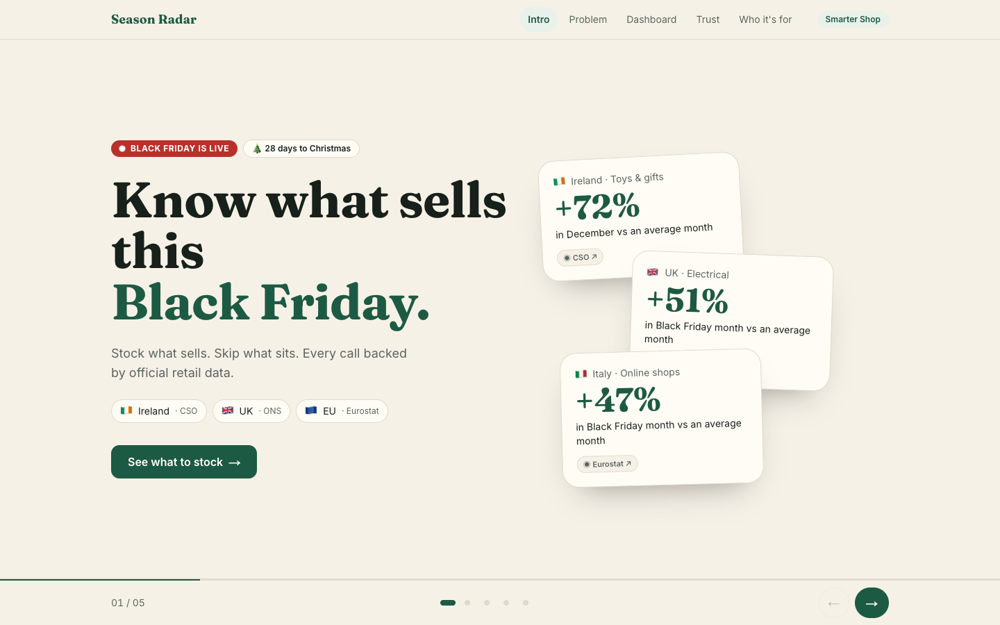
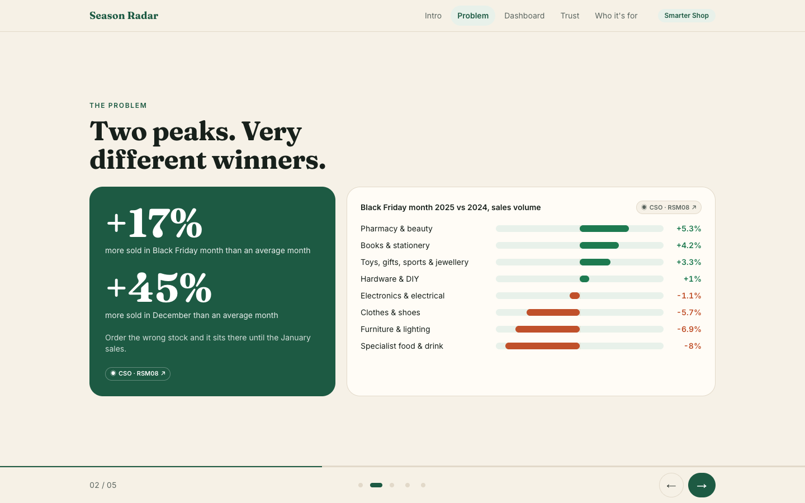
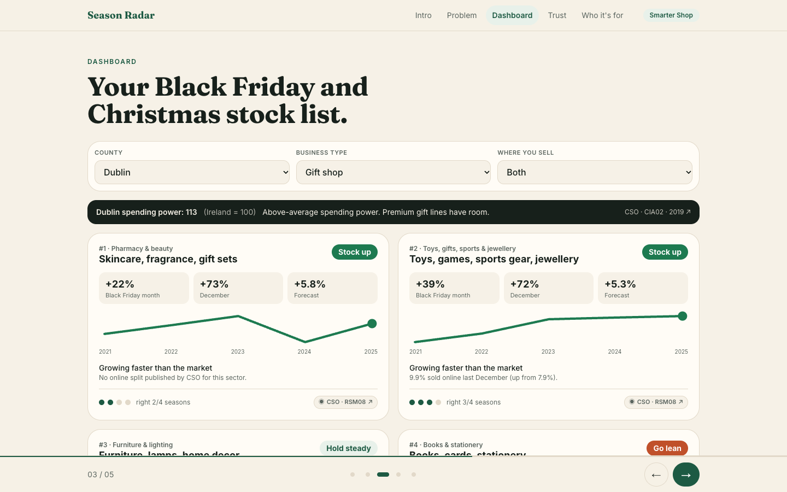
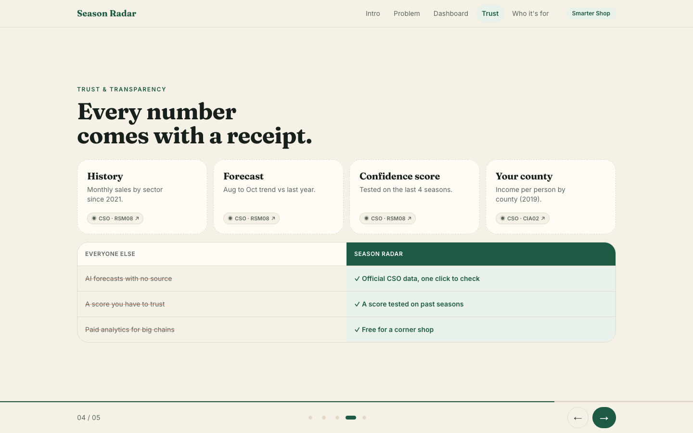

# Season Radar

Know what sells this Black Friday and Christmas. Stock what sells, skip what sits.

Live demo: https://season-radar.vercel.app



## Why it exists

- Black Friday and Christmas are the two biggest selling peaks of the year.
- Irish shops sell 17% more in November and 45% more in December than in an average month.
- Small sellers still order on gut feel, and the wrong stock sits on the shelf until the January sales.
- Big chains pay analysts for this. A corner shop has a spreadsheet and a hunch.



## Who it's for

- Local shops: gift shops, pharmacies, boutiques, toy shops.
- Online sellers on Amazon, Etsy and eBay.
- Small chains ordering stock for a few stores.

## What it does

- Pick your county, your business type and where you sell.
- Get a ranked list of product groups, each marked Stock up, Hold steady or Go lean.
- Each card shows Black Friday month, December and a forecast, plus a chart of the last five seasons.
- A confidence score shows how often the method called the direction right over the last four seasons.
- Your county's spending power sizes the local market.



## Every number has a receipt

- Every figure links to the official table it came from, so anyone can check it in one click.
- No numbers are made up or guessed. If a source doesn't publish something, the app says so.

| Market | Source | What we use |
| --- | --- | --- |
| Ireland | [CSO RSM08](https://data.cso.ie/table/RSM08) | Monthly retail sales volume by sector |
| Ireland | [CSO RSM07](https://data.cso.ie/table/RSM07) | Share of sales made online |
| Ireland | [CSO CIA02](https://data.cso.ie/table/CIA02) | Income per person by county (2019, latest on the API) |
| UK | [ONS retail sales index](https://www.ons.gov.uk/businessindustryandtrade/retailindustry/datasets/retailsales) | Monthly retail sales volume by sector |
| EU | [Eurostat sts_trtu_m](https://ec.europa.eu/eurostat/databrowser/view/sts_trtu_m/default/table) | Monthly retail sales volume by sector and country |



## How the numbers work

- Black Friday month lift: November sales vs an average month in 2025.
- Christmas lift: December sales vs an average month in 2025.
- Forecast: the last three months of sales vs the same months a year earlier.
- Stock call: Stock up if a sector grows 1.5 points faster than the market, Go lean if 1.5 slower, otherwise Hold steady.
- Confidence: we replayed the forecast on 2022 to 2025 and count how often it picked the right direction against the market.
- Sector trends are national. The county figure sizes your local market and doesn't change the trend.

## Run it locally

```bash
npm install
npm run dev
```

Open http://localhost:3000. Use the arrow keys or swipe to move between slides.

## Refresh the data

```bash
node scripts/fetch-cso.mjs      # Ireland: CSO sales, online share, county income
node scripts/fetch-markets.mjs  # UK (ONS) and EU (Eurostat), merged with Ireland
```

- Both scripts call free public APIs. No keys needed.
- Output lands in `src/data/`.

## Built with

- Next.js and React
- Tailwind CSS
- Motion for animation
- Deployed on Vercel

## What's next

- Market picker in the dashboard for the UK and EU (data is already in `src/data/markets.json`).
- Plug in a seller's own Shopify or Amazon sales.
- County-level demand from bank card-spend data.

Built at Codex Night Dublin 2026 for the Smarter Shop track.
